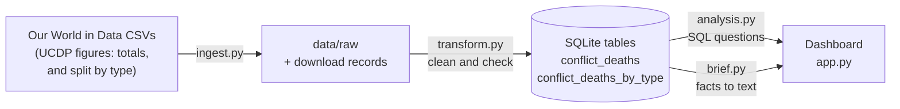

# Conflict Risk Monitor

A small data pipeline and dashboard that tracks deaths in armed conflicts by country since 1989, and flags countries where violence has risen sharply against their own recent history.

It is a learning project. The aim was to build one data product end to end: collect the data, check it, store it, ask questions of it with SQL, and present the answers to a non-technical reader.

## What it does

- **Pipeline.** Downloads the latest figures, checks them against a set of data quality rules, and loads them into a SQL database. One command.
- **Dashboard.** Shows the worldwide trend, the ten most affected countries in a chosen year, and a trend for any country.
- **Type of violence.** Splits deaths, worldwide and for each country, into fighting between states, civil conflict, fighting between armed groups, and violence against civilians.
- **Escalation watchlist.** Lists countries whose deaths in a year are well above their own five-year average. The thresholds can be changed on screen.
- **Country brief.** Writes a short paragraph for any country, built only from figures in the database and marked as a draft for analyst review.

## How it works



| File | What it is for |
| --- | --- |
| `run_pipeline.py` | Runs the three pipeline steps in order and prints a summary |
| `conflict_monitor/config.py` | Every path, URL and threshold, in one place |
| `conflict_monitor/ingest.py` | Downloads the raw file and records where and when it came from |
| `conflict_monitor/transform.py` | Cleans the data, applies the quality rules, loads it into SQLite |
| `conflict_monitor/analysis.py` | The questions asked of the data, written as SQL |
| `conflict_monitor/brief.py` | Collects the facts for one country and turns them into a paragraph |
| `app.py` | The Streamlit dashboard. Layout only; it calls the files above |
| `tests/` | Automated tests, run on a tiny sample file with fictional countries |
| `.github/workflows/ci.yml` | Runs the tests on GitHub every time code is pushed |

## Run it

You need Python 3.10 or newer.

```bash
python -m venv .venv

# Windows
.venv\Scripts\activate
# macOS or Linux
source .venv/bin/activate

pip install -r requirements.txt

python run_pipeline.py     # download, check, load
pytest                     # run the tests
streamlit run app.py       # open the dashboard
```

If the download is blocked on your network, download the full CSV by hand from both source pages, [totals](https://ourworldindata.org/grapher/deaths-in-armed-conflicts-by-country) and [split by type](https://ourworldindata.org/grapher/deaths-in-armed-conflicts-by-type), and run:

```bash
python run_pipeline.py --source path/to/totals.csv --type-source path/to/by_type.csv
```

The two options must be used together, so the database never mixes two different releases.

To see the dashboard without any real data, use the fictional sample files:

```bash
python run_pipeline.py --source tests/fixtures/sample_conflict_deaths.csv --type-source tests/fixtures/sample_conflict_deaths_by_type.csv
```

### Viewing the dashboard on other devices

By default the dashboard is at `http://localhost:8501` on the computer running it. To open it from a phone or another computer on the same network:

1. Start it so it listens on the network, not only on this computer:

   ```bash
   streamlit run app.py --server.address 0.0.0.0
   ```

2. On Windows, the firewall blocks this until you allow it:
   - Set the network to **Private** (Settings → Network & Internet → your connection). Do this only on a network you trust, such as your home network.
   - Allow port 8501 on Private networks only. In a Command Prompt run as administrator, paste this as one line:

     ```bat
     netsh advfirewall firewall add rule name="Conflict Risk Monitor dashboard" dir=in action=allow protocol=TCP localport=8501 profile=private
     ```

     To remove it later: `netsh advfirewall firewall delete rule name="Conflict Risk Monitor dashboard"`.

3. Find this computer's address with `ipconfig` (the "IPv4 Address", such as `192.168.0.20`), and open `http://<that address>:8501` on the other device.

Notes:

- The other device must be on the same network. Guest Wi-Fi networks usually stop devices reaching each other.
- There is no login, so anyone on that network can open the dashboard. The data is public, but only do this on a network you trust.
- The dashboard runs only while the terminal that started it is open. Press `Ctrl+C` in that terminal to stop it. Run only one copy at a time.
- The address can change after the computer or router restarts. If the link stops working, check `ipconfig` again.

## The data

**Source.** [Deaths in armed conflicts based on where they occurred](https://ourworldindata.org/grapher/deaths-in-armed-conflicts-by-country), published by Our World in Data from the Uppsala Conflict Data Program (UCDP). At the time of writing the source page cites the UCDP Georeferenced Event Dataset v26.1, plus UCDP Candidate Events data for the preliminary year.

**What a number means.**

- UCDP counts an armed conflict once a dispute between organised groups, or between an organised group and civilians, causes at least 25 deaths in a year.
- The figures are deaths of combatants and civilians caused directly by fighting. Deaths from disease or hunger caused by a conflict are not included, so real tolls are higher.
- Deaths are assigned to the country where they happened.
- These are UCDP's "best" estimates. UCDP also publishes low and high estimates, which this project does not use.
- The most recent year is preliminary and covers only part of the year. The pipeline flags it and leaves it out of every comparison.

**Split by type of violence.** A second file, [Deaths in armed conflicts by type](https://ourworldindata.org/grapher/deaths-in-armed-conflicts-by-type), from the same publisher, splits the same deaths into UCDP's five types: interstate (between states), intrastate (civil conflict), non-state (between armed groups), one-sided violence (against civilians) and extrasystemic (none since 1989). It is built from the same UCDP events and assigns them to countries the same way, so the pipeline checks that the five types add up exactly to the total for every place and year. It is published for full years only, so there is no split for the preliminary year. The type says what kind of violence it was, not why a conflict started.

**Provenance.** Each download writes a record in `data/raw/` (`download_metadata.json` for the totals, `download_metadata_by_type.json` for the split by type) with the URL, the time, and a fingerprint (SHA-256) of the file. The dashboard shows the retrieval date.

**Licence.** Our World in Data's own work is CC BY 4.0. The underlying data belongs to UCDP and is subject to UCDP's terms, which should be checked before any commercial use. Cite: Davies, Pettersson and Öberg (2026), "Organized violence 1989–2025, and violent political protests", *Journal of Peace Research*. The data itself is not stored in this repository.

**No personal data.** The project holds country-level totals only.

## Design decisions

- **Stop on bad data.** If the file has negative counts, duplicate rows or missing columns, the pipeline raises an error and loads nothing. A dashboard that is down is better than one that is wrong.
- **Cross-check against the source.** After loading, the pipeline compares its own country totals with the source's World figure and reports the largest gap. It also checks that the types of violence add up to the totals.
- **Questions live in SQL, away from the screen.** `analysis.py` can be tested on its own and reused by another tool.
- **Tests never use the internet.** They run on a small invented sample, so every expected answer can be worked out by hand and the tests give the same result every time.
- **SQLite for storage.** It ships with Python, needs no server, and uses standard SQL, so moving to a bigger database later changes the connection and not the queries.
- **Template first, language model later.** The brief is built from a dictionary of facts using a fixed template, so it cannot invent anything. A language model can later be given the same dictionary and told to use nothing else.
- **The watchlist is a flag, not a forecast.** It compares a country with its own past. It is simple enough to explain in one sentence, which matters more here than sophistication.

## If this ran at scale

How each part would map onto a Microsoft data stack. This is my reading of the documentation, not something this project does.

| Here | At scale |
| --- | --- |
| Script run by hand | A scheduled pipeline or notebook in Microsoft Fabric |
| CSV in `data/raw` | Files in a Fabric lakehouse (OneLake) |
| SQLite table | A lakehouse or warehouse table, or Azure SQL |
| Streamlit dashboard | A Power BI report or an internal web app |
| Template brief | A model deployed through Microsoft Foundry, given the same facts dictionary |
| pytest and GitHub Actions | The same idea, in whichever CI tool the team uses |

## Roadmap

- [ ] Brief written by a language model, grounded in `country_facts()`, with the template kept as a fallback
- [ ] Deaths per 100,000 people, by joining a population dataset
- [ ] Region filter
- [ ] Scheduled refresh, with an alert when a country joins the watchlist

## How it was built

Built in November 2026 with AI assistance (Claude and Claude Code). The author directed the work, and reviewed and ran the code and tests.

The idea came from a Kaggle discussion, [Global Armed Conflict Analysis (1989–2025)](https://www.kaggle.com/discussions/general/681310).
